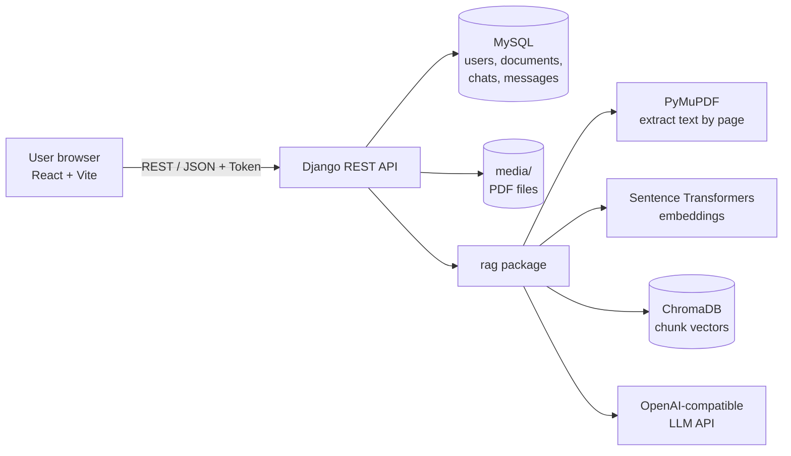
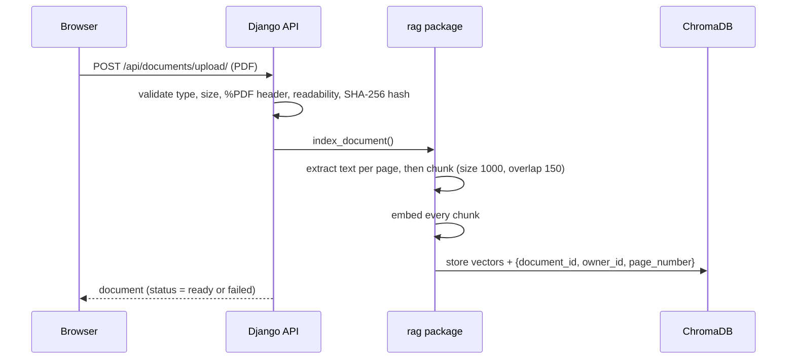
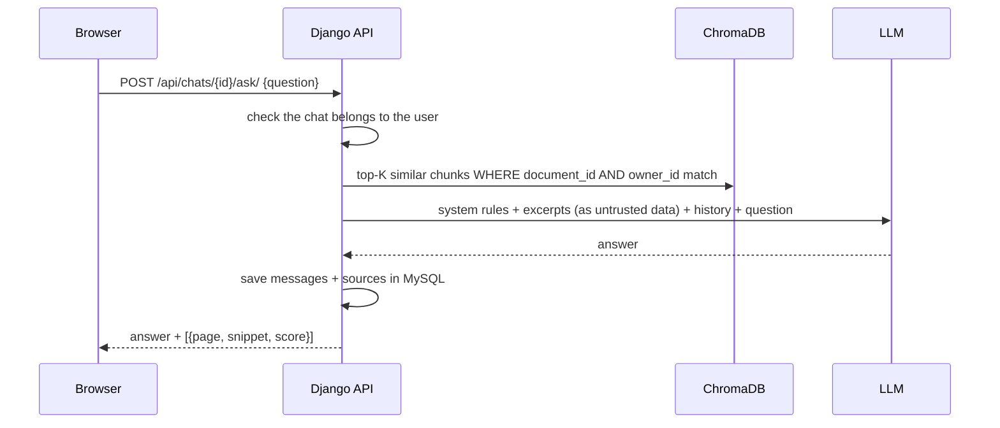
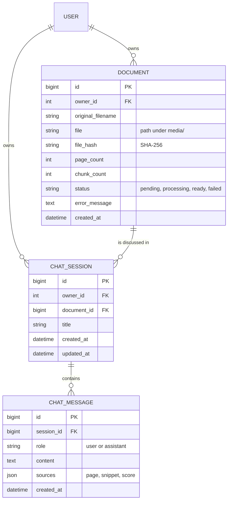

# ChatDoc – Chat with your PDFs (RAG)

ChatDoc is a full-stack web app where you upload a PDF, ask questions in plain English, and get answers
**grounded in the document** with **page numbers and text snippets** as proof.

It uses **Retrieval-Augmented Generation (RAG)**: instead of sending the whole PDF to an AI, ChatDoc finds
the few most relevant pieces of text and asks the AI to answer using only those.

| Layer | Technology |
|-------|-----------|
| Backend API | Python, Django, Django REST Framework (token authentication) |
| Relational data | MySQL (users, documents, chats, messages) |
| PDF reading | PyMuPDF |
| Embeddings | Sentence Transformers (`all-MiniLM-L6-v2`, runs locally) |
| Vector search | ChromaDB (persistent, on disk) |
| Answer generation | Any OpenAI-compatible LLM API |
| Frontend | React 18, Vite, Axios, React Router, custom responsive CSS |
| Tests | pytest, pytest-django (51 tests, no paid API calls) |

---

## Features

- Register, log in, log out (passwords hashed by Django, token auth)
- Upload PDFs with validation (type, real PDF content, size, page limit) and duplicate detection
- Friendly message for scanned / image-only PDFs
- Page-aware text extraction, overlapping chunking, local embeddings, ChromaDB storage
- Grounded answers with citations (page numbers + snippets) and an honest "not found" reply
- Chat sessions: create, list, delete, clear, follow-up questions, saved history
- Document dashboard: status, page count, upload date, error messages, delete (also removes vectors + file)
- Per-user isolation everywhere (other users get 404, vectors are filtered by document **and** owner)
- Rate limiting on the question endpoint, timeouts and clear errors for LLM problems

---

## Architecture



### What happens when you upload a PDF



### What happens when you ask a question



---

## Database design (MySQL)



**Relationships**

- One user has many documents and many chat sessions.
- One document has many chat sessions. **Deletion policy:** deleting a document deletes its chats, its PDF
  file and its ChromaDB vectors (done by a `post_delete` signal, so nothing is left behind).
- One chat session has many messages. Assistant messages store their citations in the `sources` JSON column.
- `unique(owner, file_hash)` stops the same user from processing the same PDF twice.
- **Embeddings are not stored in MySQL.** They live only in ChromaDB.

---

## Folder structure

```
ChatDoc/
├── backend/
│   ├── manage.py
│   ├── pytest.ini
│   ├── requirements.txt
│   ├── .env.example
│   ├── config/            settings, urls, health view, JSON error handler
│   ├── accounts/          register / login / logout / me
│   ├── documents/         Document model, upload + validation, processing, cleanup signal
│   ├── chats/             ChatSession, ChatMessage, ask endpoint
│   ├── rag/
│   │   ├── pdf_processor.py   PyMuPDF text extraction (page numbers kept)
│   │   ├── chunking.py        overlapping chunks
│   │   ├── embeddings.py      Sentence Transformers (+ tiny fake for tests)
│   │   ├── vector_store.py    ChromaDB add / query / delete
│   │   ├── retriever.py       question -> relevant chunks (one document only)
│   │   ├── prompts.py         system prompt + message building + snippets
│   │   ├── llm_service.py     OpenAI-compatible client + friendly errors
│   │   └── pipeline.py        index_document() and answer_question()
│   ├── tests/             51 tests
│   └── media/             uploaded PDFs (never served publicly)
├── frontend/
│   ├── package.json  vite.config.js  index.html  .env.example
│   └── src/
│       ├── api/  components/  pages/  hooks/  context/  utils/
│       ├── App.jsx
│       └── main.jsx
├── .gitignore
├── LICENSE
└── README.md
```

One small improvement over the suggested layout: `rag/pipeline.py` ties the modules together so views stay thin.

---

## Setup on Windows 11 + VS Code

### 0. Install once

- **Python 3.11 or 3.12** – https://www.python.org (tick *Add Python to PATH*)
- **Node.js 20 LTS or newer** – https://nodejs.org
- **MySQL 8** – https://dev.mysql.com/downloads/installer/ (remember your root password)
- **Git** – https://git-scm.com

Open the `ChatDoc` folder in VS Code and use **Terminal → New Terminal** (PowerShell).

### 1. Create the MySQL database

```powershell
mysql -u root -p
```
```sql
CREATE DATABASE chatdoc_db CHARACTER SET utf8mb4 COLLATE utf8mb4_unicode_ci;
EXIT;
```

### 2. Backend

```powershell
cd backend
python -m venv venv
venv\Scripts\Activate.ps1
pip install -r requirements.txt
copy .env.example .env
```

Edit `backend\.env` and set at least:

- `DJANGO_SECRET_KEY` – any long random text
- `DB_PASSWORD` – your MySQL password
- `LLM_API_KEY` (and `LLM_BASE_URL` / `LLM_MODEL` if you do not use OpenAI)

Generate a secret key if you like:
```powershell
python -c "import secrets; print(secrets.token_urlsafe(50))"
```

Create the tables and start the API:

```powershell
python manage.py migrate
python manage.py createsuperuser   # optional, for /admin/
python manage.py runserver
```

Check it works: open http://127.0.0.1:8000/api/health/ and you should see `{"status":"ok","database":"up"}`.

> **No MySQL yet?** Set `DB_ENGINE=sqlite` in `.env` to try the app with a local SQLite file.

> **First PDF is slow:** the first upload downloads the embedding model (about 90 MB) once. After that it is cached.

### 3. Frontend (second terminal)

```powershell
cd frontend
copy .env.example .env
npm install
npm run dev
```

Open http://localhost:5173, create an account, upload a PDF, click **Ask questions**.

### 4. Run the tests

```powershell
cd backend
venv\Scripts\Activate.ps1
python -m pytest
```

Tests use SQLite in memory, a temporary ChromaDB folder, a tiny fake embedder and a mocked LLM, so they are
fast, free and need no internet.

---

## Configuring the LLM

ChatDoc talks to any API that follows the OpenAI chat format. Set these in `backend/.env`:

| Provider | `LLM_BASE_URL` | `LLM_MODEL` example |
|----------|----------------|---------------------|
| OpenAI | *(empty)* | `gpt-4o-mini` |
| Groq | `https://api.groq.com/openai/v1` | `llama-3.1-8b-instant` |
| OpenRouter | `https://openrouter.ai/api/v1` | any model id from their list |
| Ollama (local, free) | `http://localhost:11434/v1` | `llama3.1` (key can be any text) |

Model names change over time, so check your provider's current list. Restart `runserver` after editing `.env`.

### RAG settings (all in `.env`)

| Variable | Default | Meaning |
|----------|---------|---------|
| `CHUNK_SIZE` | 1000 | Characters per chunk |
| `CHUNK_OVERLAP` | 150 | Characters shared by neighbouring chunks |
| `RETRIEVAL_TOP_K` | 5 | Chunks sent to the LLM per question |
| `EMBEDDING_MODEL` | all-MiniLM-L6-v2 | Must stay the same for indexing and querying |
| `CHROMA_DIR` | `backend/chroma_db` | Persistent vector database folder |

If you **change the embedding model**, delete `chroma_db/` and re-upload your PDFs (old vectors would not match).

---

## API reference

All endpoints are under `/api/`. Protected endpoints need the header `Authorization: Token <your token>`.
Errors always look like `{"error": "message", "details": {...}}`. Lists are paginated (`results`, `count`, `next`).

| Method | URL | Purpose |
|--------|-----|---------|
| GET | `/health/` | Health check (public) |
| POST | `/auth/register/` | Create account, returns token |
| POST | `/auth/login/` | Log in, returns token |
| POST | `/auth/logout/` | Invalidate token |
| GET | `/auth/me/` | Current user |
| GET | `/documents/` | My documents |
| POST | `/documents/upload/` | Upload + process a PDF (`multipart/form-data`, field `file`) |
| GET / DELETE | `/documents/{id}/` | Detail / delete (also removes vectors, file and chats) |
| GET / POST | `/chats/` | List / create chat (`{"document_id": 1}`) |
| GET / DELETE | `/chats/{id}/` | Detail / delete chat |
| GET / DELETE | `/chats/{id}/messages/` | History / clear conversation |
| POST | `/chats/{id}/ask/` | Ask a question |

### Sample requests

Register:
```bash
curl -X POST http://localhost:8000/api/auth/register/ \
  -H "Content-Type: application/json" \
  -d '{"username":"prem","email":"prem@example.com","password":"Str0ng-Pass-123"}'
```
```json
{ "token": "9944b09199c62bcf9418ad846dd0e4bbdfc6ee4b",
  "user": { "id": 1, "username": "prem", "email": "prem@example.com", "date_joined": "2026-10-18T10:00:00Z" } }
```

Upload:
```bash
curl -X POST http://localhost:8000/api/documents/upload/ \
  -H "Authorization: Token <token>" -F "file=@biology.pdf"
```
```json
{ "id": 1, "original_filename": "biology.pdf", "file_size": 183204, "page_count": 12,
  "chunk_count": 41, "status": "ready", "error_message": "", "created_at": "2026-10-18T10:05:00+05:30" }
```

Create a chat and ask:
```bash
curl -X POST http://localhost:8000/api/chats/ -H "Authorization: Token <token>" \
  -H "Content-Type: application/json" -d '{"document_id":1}'

curl -X POST http://localhost:8000/api/chats/1/ask/ -H "Authorization: Token <token>" \
  -H "Content-Type: application/json" -d '{"question":"What is photosynthesis?"}'
```
```json
{
  "user_message": { "id": 1, "role": "user", "content": "What is photosynthesis?", "sources": [], "created_at": "..." },
  "assistant_message": {
    "id": 2, "role": "assistant",
    "content": "Photosynthesis is the process plants use to turn sunlight, water and carbon dioxide into sugar and oxygen (page 3).",
    "sources": [
      { "page": 3, "snippet": "Photosynthesis is the process plants use to turn sunlight...", "score": 0.71, "chunk_id": "doc1-chunk12" }
    ],
    "created_at": "..."
  },
  "chat_title": "What is photosynthesis?"
}
```

### Status codes you will see

`201` created · `200` OK or duplicate upload · `204` deleted · `400` validation error · `401` not logged in ·
`404` not found *or not yours* · `409` document not ready · `429` rate limit (ours or the LLM's) ·
`503` LLM not configured · `504` LLM timeout · `502` LLM failure

---

## How the RAG answers stay honest

1. **Retrieval is scoped.** ChromaDB queries always filter on `document_id` **and** `owner_id`, so a question can never see another document or user.
2. **Strict system prompt.** The model must use only the excerpts, never invent facts or pages, and reply with a fixed "not found" sentence otherwise. When it does, ChatDoc shows **no** citations.
3. **PDF text is untrusted.** Excerpts are wrapped in `<excerpt page="N">` tags, and the prompt tells the model never to follow instructions found inside them (prompt-injection defence).
4. **Only the top-K chunks** are sent, never the whole PDF.
5. **Verifiable sources.** Each answer returns page numbers and snippets taken from the stored chunks (not generated by the LLM).

---

## Security notes

- Secrets only in `.env` (git-ignored); `.env.example` has placeholders only. With `DEBUG=False`, the app refuses to start without `DJANGO_SECRET_KEY`.
- Passwords hashed by Django; password-strength validators enabled.
- Token authentication; every list/detail query is filtered by `owner=request.user`.
- Uploads: extension, size, `%PDF-` header and a real PyMuPDF open are all checked. Files are stored under a random name (`documents/<user_id>/<uuid>.pdf`), so file names cannot cause path traversal.
- PDFs are **not** served by any URL; only the API reads them.
- Throttling: asking (`30/min`), login/register (`20/min`), uploads (`20/hour`), all adjustable in `.env`.
- LLM calls have a timeout and one retry; error messages shown to users never contain server internals.
- CORS is limited to the React dev server origin(s).
- Token authentication is used instead of cookies, so CSRF protection is not needed for the API (Django's CSRF middleware still protects `/admin/`). The token is kept in `localStorage`, which is simple but readable by any script on the page. For a production app consider HttpOnly cookie sessions.

---

## Troubleshooting

| Problem | Fix |
|---------|-----|
| `pip install mysqlclient` fails | Use Python 3.11/3.12 on Windows (pre-built wheels exist). Upgrade pip: `python -m pip install --upgrade pip`. As a fallback, set `DB_ENGINE=sqlite`. |
| `Access denied for user 'root'` | Wrong `DB_USER` / `DB_PASSWORD` in `.env`. |
| `Unknown database 'chatdoc_db'` | Run the `CREATE DATABASE` command from step 1. |
| `DJANGO_SECRET_KEY is not set` | Create `backend/.env` (copy `.env.example`) or set `DJANGO_DEBUG=True` for local dev. |
| "running scripts is disabled" when activating the venv | Run once: `Set-ExecutionPolicy -Scope CurrentUser RemoteSigned` |
| Frontend shows "Cannot reach the server" | Backend is not running, or `VITE_API_URL` is wrong. Restart `npm run dev` after editing `frontend/.env`. |
| CORS error in the browser console | Add your frontend URL to `CORS_ALLOWED_ORIGINS` and restart Django. |
| First upload takes a long time | The embedding model is downloading once (~90 MB). Needs internet the first time. |
| "No selectable text was found" | The PDF is a scan. Run OCR on it first, then upload again. |
| "The AI service is not configured" (503) | Set `LLM_API_KEY` in `.env` and restart the server. |
| "rejected the API key" | The key is wrong, expired, or does not match `LLM_BASE_URL`. |
| 429 "rate limit" | Wait a minute, or check your provider's quota. |
| Answers say "not found" too often | Increase `RETRIEVAL_TOP_K` (for example 8) or `CHUNK_SIZE`, then re-upload the PDF. |
| Changed `EMBEDDING_MODEL` and results look odd | Delete `backend/chroma_db/` and re-upload your PDFs. |

---

## Put it on GitHub

```powershell
cd ChatDoc
git init
git add .
git status        # make sure .env is NOT listed
git commit -m "Initial commit: ChatDoc RAG app"
git branch -M main
git remote add origin https://github.com/<your-username>/ChatDoc.git
git push -u origin main
```

---

## Deployment guidance

- **Backend:** run with `gunicorn config.wsgi` (Linux host) or Waitress (Windows) behind Nginx or Caddy with HTTPS. Set `DJANGO_DEBUG=False`, a strong `DJANGO_SECRET_KEY`, real `DJANGO_ALLOWED_HOSTS`, `SECURE_SSL_REDIRECT=True`, and `CORS_ALLOWED_ORIGINS` to your frontend URL.
- **Database:** managed MySQL with a dedicated user, not `root`.
- **Persistent storage:** keep `media/` and `chroma_db/` on a persistent disk or volume (they are lost on ephemeral containers).
- **Frontend:** `npm run build` creates `frontend/dist`, which any static host (Netlify, Vercel, Nginx) can serve. Set `VITE_API_URL` to your API before building.
- **Scaling:** PDF processing currently happens inside the upload request (simple and easy to follow). For large files or many users, move it to a background worker (Celery + Redis).

---

## Ideas for future enhancements

- Background processing with Celery and live progress updates
- Streaming answers (Server-Sent Events) for a typing effect
- OCR (Tesseract) for scanned PDFs
- Ask across several PDFs at once
- Hybrid search (keyword + vector) and a re-ranking step
- Highlight the cited text inside an in-app PDF viewer
- Cookie-based sessions or JWT with refresh tokens
- Docker Compose setup (MySQL + backend + frontend)
- GitHub Actions to run tests on every push
- Markdown rendering for answers, answer feedback (thumbs up / down)

---

## Interview talking points

- Why RAG instead of sending the whole PDF (cost, context limits, grounding, citations)
- Why vectors live in ChromaDB and relational data in MySQL (the right tool for each job)
- Chunking with overlap, and why the same embedding model must be used for indexing and querying
- How per-user isolation is enforced at both the API layer and the vector-query layer
- How prompt injection from PDF content is handled
- How LLM failures (missing key, timeout, rate limit) are surfaced without leaking internals
- How the tests avoid paid API calls (mocked LLM, fake embeddings, temporary stores)

## License

MIT, see [LICENSE](LICENSE).
